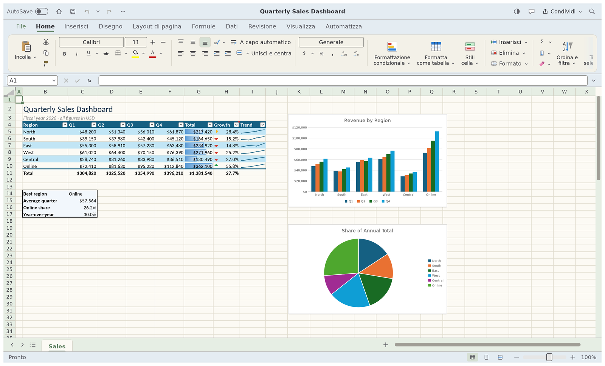

<h1 align="center">SheetCalc.it</h1>

<p align="center">
  <b>Foglio di calcolo open source in stile Excel, scritto in Rust, con interfaccia e formule in italiano.</b>
</p>

<p align="center">
  
</p>

SheetCalc.it è una versione italiana di [GridCraft](https://github.com/storytold/gridcraft), il foglio di
calcolo open source di storytold scritto in puro Rust. Funziona in modo nativo su Windows, macOS e
Linux. Usa il formato **.xlsx** come formato nativo, quindi i file si scambiano normalmente con Excel.

## Cosa cambia rispetto a GridCraft

- **Interfaccia in italiano**, con la terminologia di Excel («Blocca riquadri», «Unisci e centra»,
  «Formattazione condizionale»…). Il programma parte in italiano; la lingua si cambia da
  Visualizza → Lingua dell'interfaccia.
- **Formule in italiano**: `SOMMA`, `SE`, `CONTA.SE`, `SOMMA.PIÙ.SE`, `CERCA.VERT`, `OGGI`,
  `SE.ERRORE`, `VERO`/`FALSO` e un centinaio di altre funzioni. Il separatore tra gli argomenti è il
  punto e virgola e il separatore decimale è la virgola, come in Excel italiano. Nei file `.xlsx` le
  formule restano salvate con i nomi inglesi, per cui si aprono senza problemi in Excel.
- **Tema pastello**: avorio, azzurro polvere e verde salvia, testo antracite, nessun bianco abbagliante
  (il bianco puro resta solo nei campi di testo).
- **Icona e nome** propri.
- **Modalità portatile** (vedi sotto).

Tutto il resto, cioè motore di calcolo, grafici, tabelle pivot, formattazione condizionale, ordinamento
e filtri, convalida dei dati e altro, è il lavoro di GridCraft. Il progetto originale è in **alpha**.
Non tutte le descrizioni delle funzioni e alcune finestre sono già tradotte: ciò che manca appare in
inglese.

## Come compilare su Windows

Servono [Rust](https://rustup.rs) (toolchain `x86_64-pc-windows-gnu`) e un compilatore C per Windows,
ad esempio [WinLibs](https://winlibs.com) (UCRT, 64 bit) oppure MSYS2.

```
git clone https://github.com/lorenzodapolito-oss/SheetCalc.it
cd SheetCalc.it
set PATH=<cartella di WinLibs>\mingw64\bin;%PATH%
cargo run --release -p gridcraft
```

La prima compilazione richiede circa 15–20 minuti. L'eseguibile finito è `target\release\SheetCalc.it.exe`
ed è un file unico: non servono DLL né altre cartelle.

Altri comandi utili:

```
cargo run --release -p gridcraft -- --sample sales    # apre un esempio (sales, budget, grades)
cargo run --release -p gridcraft -- libro.xlsx        # apre un file
cargo xtask ci                                        # formattazione, clippy, test, controlli
```

## Modalità portatile

Per tenere impostazioni e log accanto al programma, metti nella stessa cartella di `SheetCalc.it.exe`
un file vuoto chiamato `portable.txt`: la cartella `sheetcalc-data` viene creata da sola al primo avvio.
In alternativa crea direttamente la cartella `sheetcalc-data`. Cancella entrambi per tornare al
comportamento normale, con le impostazioni nel profilo di Windows.

## Per chi vuole approfondire

La documentazione tecnica del progetto originale (architettura, formule, canale di controllo per gli
agenti, MCP, versione web) è nella cartella [`docs/`](docs/) e nel
[repository di GridCraft](https://github.com/storytold/gridcraft). Le formule in italiano sono descritte
nel codice in `crates/formula/src/input.rs`, con i test in `crates/formula/tests/italian_input.rs`.

## Licenza e crediti

SheetCalc.it è distribuito con la stessa licenza di GridCraft: [MIT](LICENSE-MIT) oppure
[Apache-2.0](LICENSE-APACHE), a scelta. Copyright (c) 2026 ArtCraft Team e contributori di GridCraft;
adattamento italiano di Lorenzo D'Apolito. Gli avvisi richiesti sono in [NOTICE](NOTICE) e le risorse
(immagini, icone) sono elencate in [ATTRIBUTION.md](ATTRIBUTION.md).

Il nome ArtCraft e i suoi loghi sono marchi dell'ArtCraft Team e non sono coperti da questa licenza.
In questa versione modificata i loghi sono stati rimossi, come richiesto dalle
[condizioni d'uso del marchio](docs/brand/LICENSE-brand.txt).
